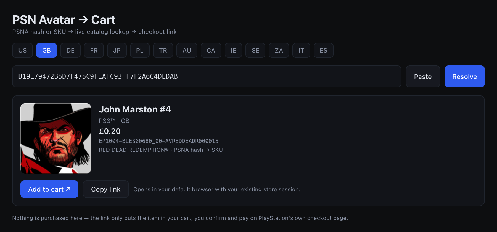

# PSN Avatar Cart

A web tool that turns a **PSNA hash**, a **PSN SKU**, or a **`.edat` file** into a working
PlayStation Store cart link — for PS3-era avatars that the web store no longer lets you browse.

### → **https://abusager13.github.io/psn-avatar-cart/**

No install, no account, no build step: it is a static site.


## What it does

1. **Input** — paste a 40-character PSNA hash, a full SKU like
   `UP1004-BLUS30418_00-AVARDRSHADOWWOLF`, or click **Open .edat…** and pick a file from the archive
   (the SKU is read straight out of its header).
2. **Resolve** — queries Sony's live catalog for the selected store region and shows name,
   platform, price and artwork.
3. **Regional twin** — the same avatar is a *different product* in each region. If the SKU 404s,
   the site resolves it in its home store, then matches the name in the store you picked.
4. **Region hunt** — failing that, it probes the other 13 tracked stores and tells you where the
   item is still sold.
5. **Cart** — builds `checkout.playstation.com/add/<SKU>?clientId=…` and opens it in a new tab,
   where your existing PlayStation Store session lives.

Nothing is purchased here. There is no login, no storage, and no backend — the link only fills your
cart, and you confirm and pay on PlayStation's own page.

## Screenshots

| Result | Regional twin |
|---|---|
|  |  |

## Why a static site works

Sony's legacy catalog endpoint sends `Access-Control-Allow-Origin: *`, so the browser can query it
directly — no proxy, no serverless function, no precomputed prices:

```
GET store.playstation.com/store/api/chihiro/00_09_000/container/{REGION}/en/19/{SKU}/
→ access-control-allow-origin: *
```

| Step | Source |
|---|---|
| Catalog lookup | `store.playstation.com/store/api/chihiro/…` |
| Regional match | `commerce1.api.np.km.playstation.net/store/api/chihiro/…/search/…` |
| Cart link | `checkout.playstation.com/add/{SKU}?clientId=…` |
| Hash → SKU | [`site/data/avatar-sku-index.tsv`](site/data/avatar-sku-index.tsv), 5,415 rows |
| `.edat` → SKU | content ID at byte `0x10` of the file header, read in the browser |

The `clientId` is Sony's public first-party OAuth client identifier, visible in their own store
page source. It is not a secret, and not ours.

## Layout

```
site/            the whole product: index.html, styles.css, app.js, data/
docs/            screenshots used by this README
.github/         Pages deploy workflow
```

Editing the site is editing three files. There is no bundler, no framework, no `node_modules`.

## Limitations

- The bundled index only covers the archived collection. Unknown hashes are rejected — use
  **Open .edat…** for anything else.
- Region matters: `EP*` SKUs are European, `UP*` are SCEA/US. A US account cannot buy an `EP` item.
- Delisted items return `DataNotFound` in every region and cannot be carted.
- The regional-twin match is heuristic (name containment + `avatar` category); where regional names
  diverge heavily — Japanese titles especially — it will not find the match.
- The cart only fills if the browser you open it in has a signed-in PlayStation Store session for
  the region you selected.

## Attribution

`site/data/avatar-sku-index.tsv` was derived from
[lI-Isekai-Il/PS3-Avatars-Edat](https://github.com/lI-Isekai-Il/PS3-Avatars-Edat) by reading the
content ID out of each EDAT header. It contains product identifiers and game names only — no
artwork, no avatar images, no Sony assets. Artwork shown in the UI is fetched from Sony's CDN at
runtime and is never bundled or proxied.

## Legal

Unofficial fan tool. Not affiliated with, endorsed by, or sponsored by Sony Interactive
Entertainment. PlayStation and PSN are trademarks of Sony Interactive Entertainment LLC. Use it for
your own account, at your own risk, and within the PlayStation Network terms you agreed to.

Source available — all rights reserved. No open-source license is granted; the bundled index is
derived from a third-party archive and is not the author's to license.
