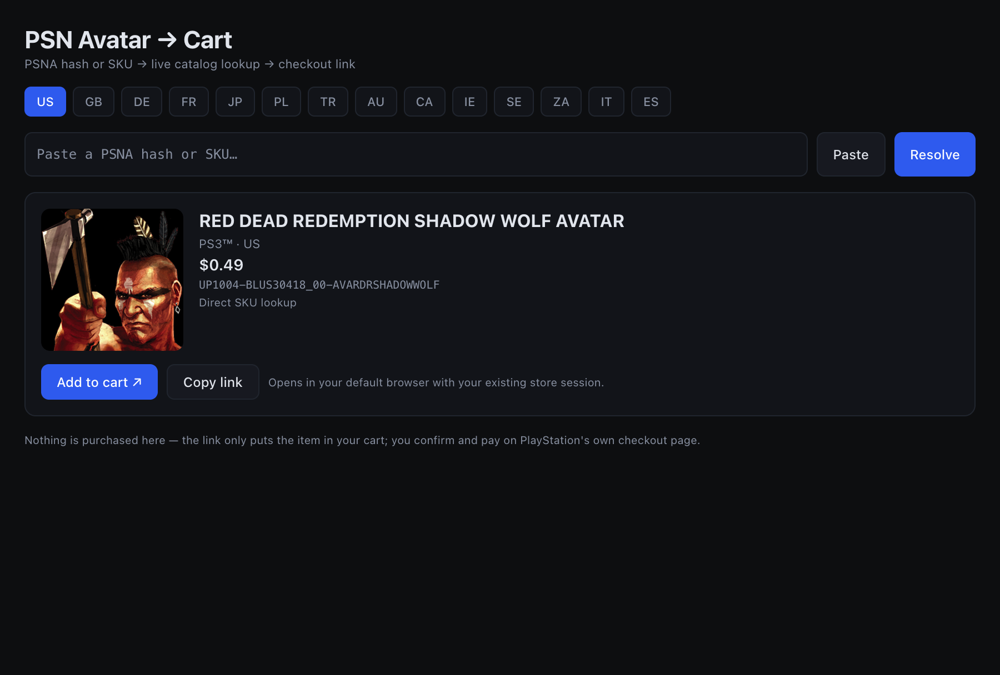
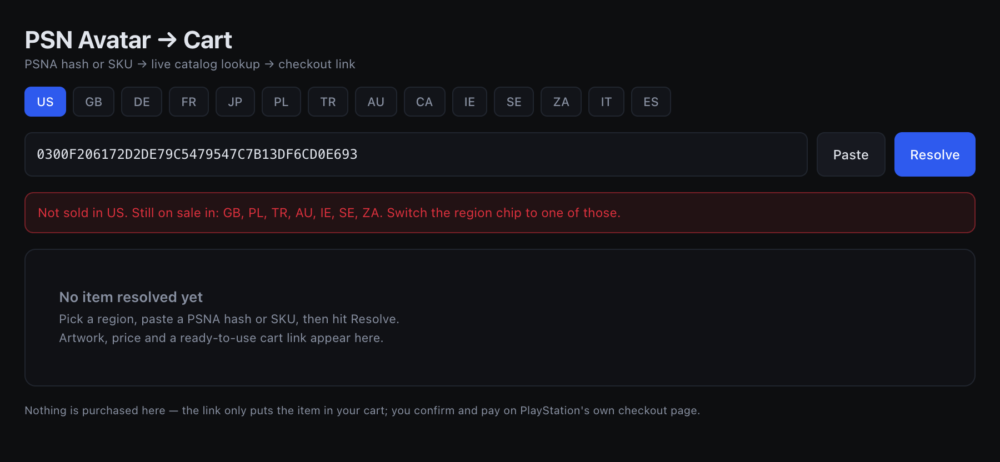

# PSN Avatar Cart

Desktop app that turns a **PSNA hash**, a **PSN SKU**, or a **`.edat` file** into a working
PlayStation Store cart link — for PS3-era avatars that the web store no longer lets you browse.

Public repo · macOS + Windows · React Native (react-native-web) UI in an Electron shell



## What it does

1. **Input** — paste a 40-character PSNA hash, a full SKU like
   `UP1004-BLUS30418_00-AVARDRSHADOWWOLF`, or click **Open .edat…** and pick a file from the
   archive (the SKU is read straight out of its header).
2. **Resolve** — queries Sony's live catalog for the selected store region and shows name,
   platform, price and artwork.
3. **Region hunt** — if that region returns `404`, the app probes the other 13 tracked stores and
   tells you where the item is still sold.
4. **Cart** — builds `checkout.playstation.com/add/<SKU>?clientId=…` and opens it in your default
   browser, where your PlayStation Store session already lives.

Nothing is purchased by the app. It has no login field, stores no credentials, and never sees a
password — the link only fills your cart, and you confirm and pay on PlayStation's own page.

## Screenshots

| US result | Region hunt |
|---|---|
|  |  |

## Run it

```bash
cd desktop
npm ci
npm start
```

Needs Node 20+. `npm start` builds the renderer with Vite and launches Electron.

## Build a bundle

```bash
cd desktop
npm run build
npm run bundle        # assembles for the platform you are on
```

- macOS → `desktop/release/PSN Avatar Cart.app`
- Windows → `desktop/release/PSN Avatar Cart-win32-x64/` (contains `PSN Avatar Cart.exe`)

`scripts/bundle.mjs` copies the Electron runtime that npm already installed and drops the app into
it. It deliberately avoids `electron-packager`, which fails silently on some machines while
extracting its own Electron download; it also copies framework symlinks verbatim, which
`fs.cpSync` otherwise rewrites into absolute paths and breaks the macOS bundle.

CI builds both platforms on every push to `main` — see `.github/workflows/build.yml`.

## How it works

| Step | Endpoint |
|---|---|
| Catalog lookup | `store.playstation.com/store/api/chihiro/00_09_000/container/{REGION}/en/19/{SKU}/` |
| Cart link | `checkout.playstation.com/add/{SKU}?clientId=2eb25762-877f-4140-b341-7c7e14c19f98` |
| Hash → SKU | `resources/avatar-sku-index.tsv` (5,415 rows) |
| `.edat` → SKU | content ID at byte `0x10` of the file header |

The catalog endpoint is Sony's legacy Chihiro API. It still indexes PS3 content, including avatars
that have no remaining storefront UI, and it returns the price and artwork the app displays. The
checkout endpoint is the same one Sony's own store uses — the `clientId` is Sony's public
first-party OAuth client identifier, not a secret and not ours.

## Limitations

- The bundled index only covers the archived collection. Unknown hashes are rejected — use
  **Open .edat…** for anything outside it.
- Region matters: `EP*` SKUs are European, `UP*` are SCEA/US. A US account cannot buy an `EP` item.
- Delisted items return `DataNotFound` in every region and cannot be carted.
- Builds are unsigned. macOS may need right-click → Open; Windows will show a SmartScreen warning.

## Attribution

`resources/avatar-sku-index.tsv` was derived from
[lI-Isekai-Il/PS3-Avatars-Edat](https://github.com/lI-Isekai-Il/PS3-Avatars-Edat) by reading the
content ID out of each EDAT header. It contains product identifiers and game names only — no
artwork, no avatar images, no Sony assets.

## Legal

Unofficial fan tool. Not affiliated with, endorsed by, or sponsored by Sony Interactive
Entertainment. PlayStation and PSN are trademarks of Sony Interactive Entertainment LLC. Use it for
your own account, at your own risk, and within the PlayStation Network terms you agreed to.

Source available — all rights reserved. No open-source license is granted; the bundled
index is derived from a third-party archive and is not the author's to license.

## Invite collaborators

```bash
gh api -X PUT repos/abusager13/psn-avatar-cart/collaborators/<username> -f permission=push
```

Or in the browser: **Settings → Collaborators → Add people**.
